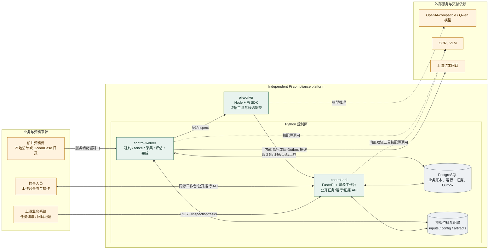
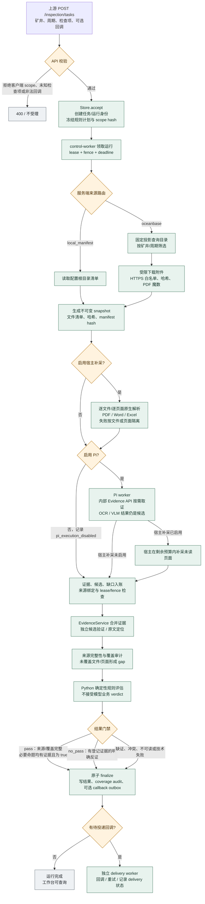
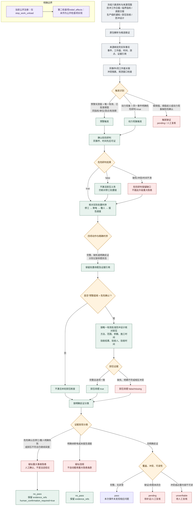

# 当前系统图

> 依据当前工作树实现整理。图中的“外部依赖”表示已定义接口或部署连接，不表示真实生产链路已经验收。当前公开注册的检查项只有 `stop_work_unload`；旧的 `relief_effects` 代码不作为公开检查项绘制。

## 1. 当前系统机构图

**边界说明**

- `control-api` 和 `control-worker` 都属于 Python 控制面，共享 PostgreSQL 与挂载资料；worker 直接使用账本/服务，不通过 HTTP 回调 API。
- Pi 只负责按冻结计划取证、调用工具并提交候选/缺口；业务状态和最终结论由 Python 控制面持有。
- `MODEL`、`OCR`、`VLM`、OceanBase 和回调接收方均为外部部署依赖；本项目不打包模型权重或推理服务。
- 旧 `compliance-service` 不在运行时架构内。

## 2. 当前系统文件合规检查流程图

**流程边界**

- 下载成功或目录有记录，不等于来源完整；最终 `pass` 仍需通过来源和覆盖审计。
- Pi、OCR/VLM 只能产生带来源的候选；候选须经服务端验证并进入确定性规则评估。
- 任务完成与回调交付分离：回调失败进入 Outbox 重试，不回滚已完成的检查结果。
- 当前本地配置可启用 Pi 和宿主补采；两条取证支路都受并发、超时、取消和租约约束。

## 3. 冲击危险停工撤人与卸压检查项流程图

**判定口径**

- 当前 v3 规则把“触发识别、危险确认、处置时序、条件性卸压核查”分开；模型输出不能直接成为业务判定。
- 缺失、时间精度不足、来源冲突和不可读内容保留为缺口或不可核验；不能把缺证画成“未执行”。
- `疑似重大事故隐患`、`疑似违规` 是带证据引用的发现分类；最终状态仍是 `pass`、`no_pass`、`pending`、`unverifiable` 或 `failed`。

## 实现依据

| 图 | 主要实现依据 |
| --- | --- |
| 当前系统机构图 | `infra/docker/compose.offline.yml`；`apps/control_api/main.py`；`apps/control_api/worker.py`；`apps/pi-worker/src/server.mjs`、`runtime.mjs`；`README.md` |
| 文件合规检查流程图 | `apps/control_api/main.py:154-175`；`apps/control_api/store.py`；`apps/control_api/sources.py:234-261`；`apps/control_api/documents.py`；`apps/control_api/evidence.py`；`apps/control_api/coverage.py`；`apps/control_api/worker.py:132-300` |
| 停工撤人与卸压流程图 | `apps/control_api/registry.py:290-295`；`apps/control_api/domain/rules.py:303-366,368-493,707-819`；`rule_assets/stop_work_unload.v2.json`；`docs/stop-work-unload-rule-2026-10-28.md` |

